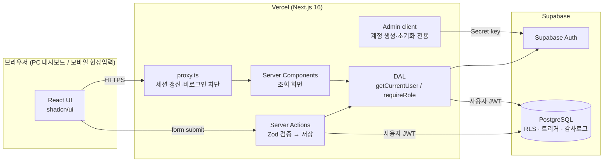
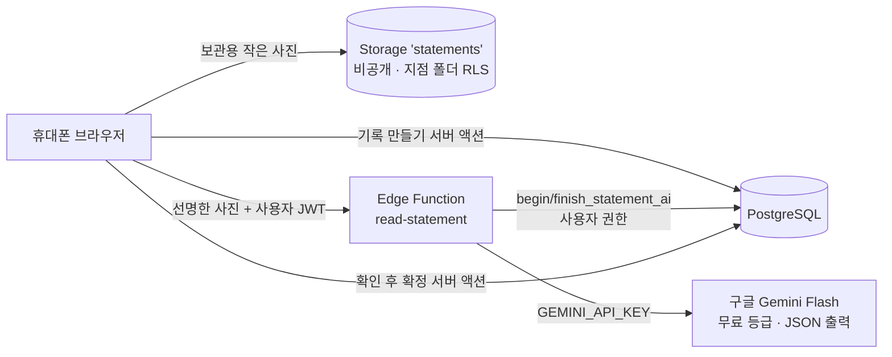
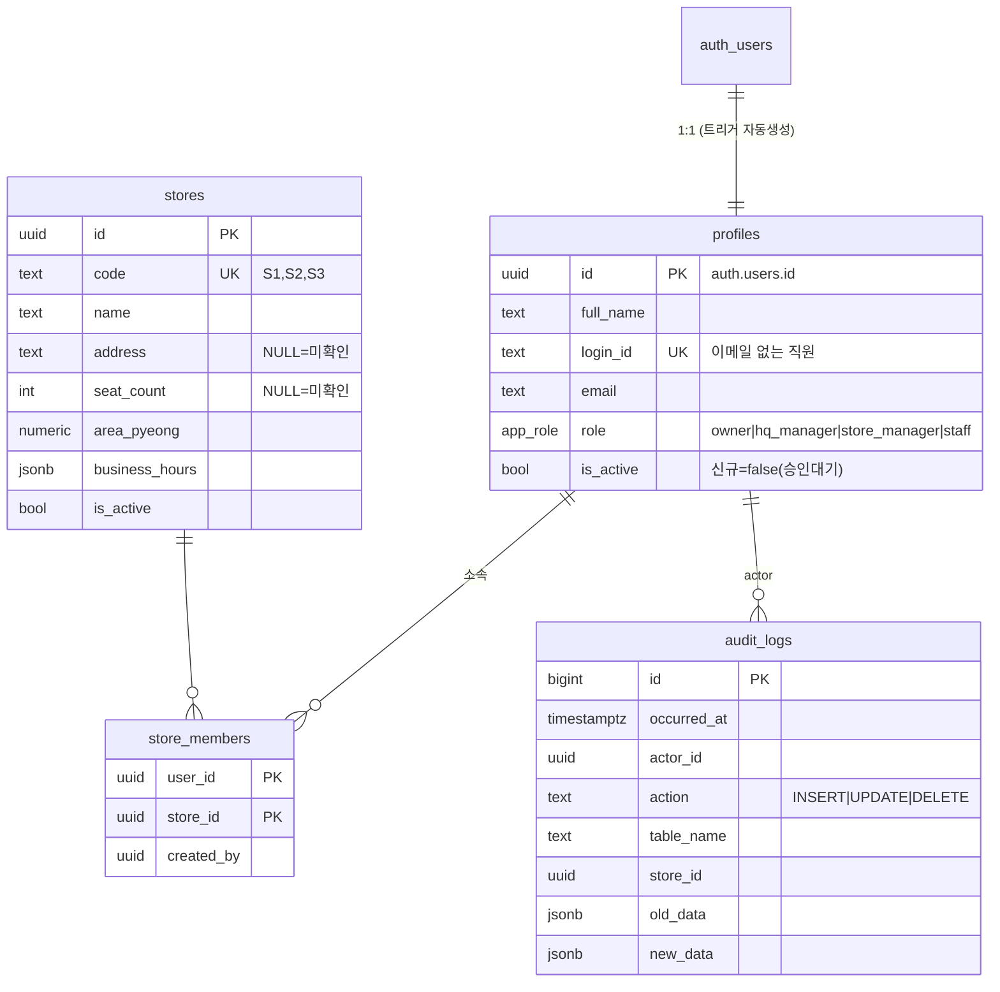

# 향미옥 경영관리 시스템 — 아키텍처 및 개발 계획

> 최종 갱신: 2026-10-12 (1단계 구현 시점)
> 범례: ✅ 구현·검증 완료 / 🟡 구현했으나 실제 Supabase 연동 미검증 / ⬜ 계획

---

## 1. 기술 선정

### 1-1. 비교

| 영역 | 채택 | 대안 | 판단 근거 (유지보수성 · 운영비) |
|---|---|---|---|
| 프레임워크 | **Next.js 16 (App Router) + React 19 + TypeScript** | Remix, SvelteKit, Vite SPA + 별도 API 서버 | 화면과 서버 로직(Server Actions)을 한 저장소·한 언어로 관리 → 1인 개발/외주 교체 시 인수인계 쉬움. Vercel 무료~Pro 플랜으로 서버 운영 불필요 |
| DB | **PostgreSQL (Supabase)** | MySQL(PlanetScale), Firebase(Firestore) | 손익·재고·원가는 관계형 + 트랜잭션 + 정확한 숫자형(numeric/bigint) 필수. Firestore 는 집계·조인·권한 표현이 약함 |
| 인증 | **Supabase Auth** | Auth.js(NextAuth), Clerk | DB 와 같은 서비스라 RLS 에서 `auth.uid()` 로 바로 권한 판단. Clerk 는 사용자 수 과금, Auth.js 는 세션/비밀번호 관리 직접 구현 필요 |
| 권한 | **Postgres RLS + 서버 DAL 이중 검사** | 앱 코드에서만 검사 | 코드 실수·API 직접 호출에도 DB 가 최종 차단 |
| UI | **Tailwind CSS 4 + shadcn/ui (Base UI)** | MUI, Ant Design | 컴포넌트 소스가 프로젝트 안에 있어 라이브러리 버전 종속 적음, 번들 작음 |
| 차트 | **Recharts** (2단계부터) | Chart.js, ECharts | React 친화적, 대시보드 수준 차트에 충분 |
| 검증 | **Zod** | Yup, Valibot | 서버 액션 입력 검증 + 타입 추론 |
| 테스트 | **Vitest + PGlite** | Jest, Docker 기반 Supabase 로컬 | PGlite(WASM Postgres)로 **실제 마이그레이션 SQL 과 RLS 를 Docker 없이** 테스트 |
| 배포 | **Vercel + Supabase** | AWS(EC2/RDS), Railway | 서버 관리 0, 자동 HTTPS, 무중단 배포 |

### 1-2. 예상 운영비 (2026년 공개 요금 기준 추정 — 가입 시 재확인 필요)

| 항목 | 시작 | 데이터·사용자 증가 시 |
|---|---|---|
| Supabase | Free (7일 미사용 시 일시정지, 백업 없음) — **개발용** | **Pro 약 $25/월** — 운영용 권장 (일일 백업, 일시정지 없음) |
| Vercel | Hobby 무료 (비상업 조건) | **Pro 약 $20/월** — 상업 운영 시 약관상 Pro 필요 |
| 도메인 | 선택 | 연 2~3만원 |

→ 운영 시 **월 약 $45 (약 6~7만원)** 수준. 직원 수에 따른 과금 없음.

### 1-3. Next.js 16 주의사항 (이 프로젝트에 적용됨)
- `middleware.ts` → **`proxy.ts`** 로 이름 변경됨.
- **Cache Components** 기본 활성: 쿠키(세션)를 읽는 컴포넌트는 반드시 `<Suspense>` 안에 둔다. 재무 데이터에는 `use cache` 를 쓰지 않는다(항상 최신값).
- `forbidden()` 은 실험 기능이라 사용하지 않고 `/forbidden` 리다이렉트로 대체.

---

## 2. 시스템 아키텍처



**권한 3중 방어**
1. `proxy.ts` — 비로그인 사용자 즉시 /login (낙관적 검사)
2. DAL (`requireUser`, `requireRole`, `authorizeAction`) — 페이지·서버액션마다 서버에서 역할 확인
3. **PostgreSQL RLS** — 최종 강제. 앱 코드에 버그가 있어도 타 지점·급여 데이터는 DB 가 반환하지 않음

**Secret key 사용 범위**: Auth 관리(계정 생성, 비밀번호 초기화, 로그인 차단)만. 업무 데이터 변경은 항상 사용자 세션으로 수행 → RLS 적용 + 감사로그에 실제 수행자 기록.

**실제 운영 배포 (2026-10-13 변경)**: 앱은 Vercel 대신 **Netlify 무료**(대표 결정). 무료 함수 10초 제한 때문에, 오래 걸리는 거래명세표 AI 읽기만
**Supabase Edge Function `read-statement`**(무료 150초)에서 실행한다.


- AI 결과는 '제안'일 뿐: 올린 사람이 사진과 비교해 확정해야 지출(`confirm_purchase_statement`, SECURITY DEFINER — 그 명세표 1장 분량만)이 생긴다.
- 상태 변경은 DB 함수로만(직접 UPDATE 정책 없음), AI 횟수 제한(한 장 3번 · 지점당 하루 50장)으로 비용 사고 방지.

---

## 3. 데이터 설계 원칙

| 원칙 | 적용 |
|---|---|
| 지점 구분 | 모든 업무 테이블에 `store_id uuid not null` + RLS `app.has_store_access(store_id)` |
| 금액 | **원 단위 정수 `bigint`**. 부동소수점 금지. 비율·원가 단가만 `numeric` |
| 수량 | `numeric(14,3)` + 기준단위(g, ml, 개). 입력 단위는 변환표로 기준단위 환산 후 저장 |
| 미입력 vs 0 | 값이 없으면 **행이 없거나 NULL**. 0원은 '실제로 0원'일 때만. 화면은 `미입력` 표시 |
| 실제 vs 추정 | 손익·원가에 `basis: actual | estimated` 구분, 추정치는 화면에 '추정' 배지 |
| 중복 방지 | 자연키 UNIQUE (예: `daily_sales (store_id, business_date)`), 생산확정 `idempotency` |
| 이력 보존 | 재고는 **원장(ledger) 방식** — 현재고는 이동기록 합계. 삭제 대신 취소(역분개) |
| 수정 이력 | `app.audit_row_change()` 트리거로 변경 전/후 JSON 저장. 감사로그는 수정·삭제 불가 |
| 시간 | `timestamptz` 저장, 영업일은 `date` (Asia/Seoul 기준) |
| 테스트 데이터 | 개발/운영 **Supabase 프로젝트 분리** + 비운영 환경 화면 상단 경고띠 |

---

## 4. ERD

### 4-1. 1단계 (✅ 구현: `supabase/migrations/20261012000100_stage1_core_auth.sql`)



### 4-2. 전체 계획 ERD (2~6단계, ⬜ 설계안 — 단계별 마이그레이션으로 추가)

```mermaid
erDiagram
  stores ||--o{ daily_sales : ""
  daily_sales ||--o{ daily_sales_revisions : "수정이력"
  sales_import_batches ||--o{ daily_sales : "CSV/엑셀 업로드"

  stores ||--o{ expenses : ""
  expense_categories ||--o{ expenses : ""
  stores ||--o{ inventory_counts : "기간말 실사"

  stores ||--o{ employees : ""
  employees ||--o| profiles : "로그인 계정(선택)"
  employees ||--o{ wage_contracts : "시급/월급 이력"
  employees ||--o{ shifts : "스케줄"
  employees ||--o{ attendance : "실제 출퇴근"
  employees ||--o{ leaves : "휴가"
  payroll_runs ||--o{ payroll_items : "급여(검증 전=초안)"

  stores ||--o{ checklist_templates : ""
  checklist_templates ||--o{ checklist_template_items : ""
  checklist_templates ||--o{ checklist_runs : "오픈/마감 실행"
  checklist_runs ||--o{ checklist_run_items : "담당자·시각"
  stores ||--o{ tasks : "업무지시·공지"

  suppliers ||--o{ items : ""
  units ||--o{ unit_conversions : ""
  items ||--o{ item_unit_conversions : "포장단위(박스=10kg)"
  stores ||--o{ store_items : "안전재고"
  items ||--o{ inventory_ledger : "입고/사용/폐기/조정/이동"
  stores ||--o{ purchase_orders : ""
  purchase_orders ||--o{ purchase_order_lines : ""
  stores ||--o{ stock_transfers : "매장간 이동"

  recipes ||--o{ recipe_versions : ""
  recipe_versions ||--o{ recipe_ingredients : "배율규칙: linear|fixed|step|custom"
  recipe_versions ||--o{ recipe_steps : "조리단계·시간·온도"
  recipe_versions ||--o{ production_batches : "목표 80/100/110/120/140L"
  production_batches ||--o{ production_inputs : "실투입 → ledger 차감(확정 시 1회)"
  production_batches ||--o| meat_yield_records : "원육/조리후 중량·수율"
```



핵심 테이블 요약 (계획)

| 테이블 | 핵심 컬럼 / 규칙 |
|---|---|
| `daily_sales` | store_id, business_date, gross_sales, discount, refund, **net_sales = gross − discount − refund (DB generated)**, card, cash, delivery, other_payment, customers, orders, memo, source(manual/csv/pos), UNIQUE(store_id, business_date) |
| `expenses` | store_id, category(식재료매입/인건비/임대료/관리비/수도광열/광고/카드수수료/배달수수료/소모품/수선/기타/감가상각), period_start~end 또는 date, amount(bigint), **basis(actual/estimated)**, 증빙메모 |
| `inventory_counts` | 기간말 실사재고 금액·수량 → **매출원가 = 기초재고 + 당기매입 − 기말재고** |
| `employees` / `wage_contracts` | 고용형태(주5/주6/파트), 입사일, 재직상태, 시급/월급 이력(적용 시작일). **급여 조회는 별도 함수 `app.can_view_payroll` 로 제한** |
| `attendance` | 실제 출근/퇴근/휴게(분), 연장·야간·휴일 구분은 **계산규칙 테이블**로 산출, 확정 전 '검증 필요' 상태 |
| `inventory_ledger` | item_id, store_id, qty_base(기준단위), movement(receipt/use/waste/adjust/transfer_in/out/production_use), unit_cost, ref_type/ref_id, **UNIQUE(ref_type, ref_id, item_id)** 로 중복 차감 방지 |
| `recipe_ingredients` | base_qty, unit, **scaling_rule**(linear: 비례 / fixed: 고정량 / step: 구간표 / custom: 수동), rule_params jsonb |
| `production_batches` | recipe_version_id, target_volume_l, **actual_volume_l**, status(draft→confirmed→cancelled), confirmed_at, 확정 시 1회만 ledger 차감(트랜잭션 + 상태 전이 체크) |
| `meat_yield_records` | raw_weight_g, cooked_usable_weight_g, **yield% = usable/raw×100**, loss_g, actual_cost, portion_g, cost_per_portion |

---

## 5. 폴더 구조

```
향미옥-경영관리/
├─ CLAUDE.md                 # 개발 규칙 (AI/개발자용)
├─ README.md                 # 비개발자용 설치·배포 안내
├─ .env.example              # 환경변수 예시
├─ docs/
│  ├─ ARCHITECTURE.md        # (이 문서) 아키텍처·ERD·계획
│  ├─ ADMIN_MANUAL.md        # 관리자 사용 설명서
│  └─ STATUS.md              # 단계별 구현·검증 현황
├─ supabase/
│  ├─ migrations/            # 단계별 SQL (순서대로 적용)
│  └─ bootstrap-owner.sql    # 최초 대표 계정 지정
├─ src/
│  ├─ proxy.ts               # 세션 갱신·비로그인 차단
│  ├─ app/
│  │  ├─ login/              # 로그인 (페이지·액션·폼)
│  │  └─ (app)/              # 로그인 후 화면 (사이드바 레이아웃)
│  │     ├─ page.tsx         # 홈/통합 대시보드
│  │     ├─ account/         # 내 계정(비밀번호 변경)
│  │     └─ admin/{users,audit}/
│  ├─ components/            # 공통 UI (ui/ = shadcn 원본)
│  └─ lib/
│     ├─ auth/               # roles(순수 규칙), dal(서버), login-id
│     ├─ data/               # 조회 함수 (server-only)
│     ├─ supabase/           # server / admin 클라이언트
│     ├─ validation/         # Zod 스키마
│     ├─ env.ts, format.ts   # 환경변수, 한국어 표시·안전 나눗셈
└─ tests/
   ├─ db/                    # PGlite + 실제 마이그레이션 RLS 테스트
   └─ unit/                  # 순수 함수 테스트
```

---

## 6. 단계별 개발 계획

| 단계 | 범위 | 상태 |
|---|---|---|
| 1 | 프로젝트 구조, DB(지점·계정·소속·감사로그), 인증, 역할 권한, RLS, 계정관리, 변경이력, 반응형 셸 | ✅ 코드·DB 테스트 / 🟡 실제 Supabase 연동 미검증 |
| 2 | 지점 설정(주소·좌석·운영시간), 일별 매출 입력(중복방지·수정이력·결제수단 합계 경고), CSV/엑셀 업로드, 통합 대시보드(기간·지점 필터, 비교 차트) | ⬜ |
| 3 | 지출 입력, 매출원가(재고변동 반영), 손익계산서(실제/추정 구분), 원가율·인건비율·영업이익률 | ⬜ |
| 4 | 직원·고용계약·스케줄·출퇴근·휴가, 인건비 집계, 급여 계산규칙(검증 전 '초안'), 오픈/마감 체크리스트, 업무지시·공지 | ⬜ |
| 5 | 품목·단위변환·구매처, 재고 원장, 발주·입고, 매장간 이동, 레시피 버전·배율규칙, 육수 생산 확정→재고차감→원가, 고기 수율 | ⬜ |
| 6 | 지점 KPI 비교(좌석당·노동시간당 매출 등), 월간 경영보고서, 엑셀 내보내기/가져오기 | ⬜ |

각 단계 완료 기준: 기능 테스트 · DB 저장 확인 · 역할별 권한 테스트 · 오류 처리 · 모바일 확인 · 정합성 · `npm run check` + `npm run build` 통과.

---

## 7. 백업 및 복구 정책 (안)

| 항목 | 정책 |
|---|---|
| 자동 백업 | 운영 Supabase **Pro 플랜 일일 자동 백업**(보존 7일). Free 플랜은 자동백업 없음 → 운영에 사용 금지 |
| 수동 백업 | 월 1회 + 대규모 변경 전 `supabase db dump` 또는 대시보드 백업 다운로드, 대표 PC·클라우드 드라이브 2곳 보관 |
| 시점 복구(PITR) | 데이터 중요도가 높아지면 PITR 애드온 검토 (유료) |
| 복구 훈련 | 분기 1회 백업본을 개발 프로젝트에 복원해 확인 |
| 삭제 정책 | 업무 데이터는 하드삭제 대신 취소/비활성. 감사로그는 삭제 불가 |
| 비밀키 | Secret key 유출 의심 시 Supabase 에서 즉시 키 교체(rotate) 후 Vercel 환경변수 갱신 |

---

## 8. 향후 확장 기능

- POS 연동 (`daily_sales.source = 'pos'`, 수집 어댑터 + 원본 보관 테이블) — 사용 POS 사 API 확인 후
- 배달앱(배민·쿠팡이츠) 정산 자료 자동 수집
- 카카오 알림톡: 매출 미입력·안전재고 미달·체크리스트 미완료 알림
- 세무사 전달용 월간 자료 자동 생성
- 직원 출퇴근 QR/위치 기반 체크
- 메뉴별 판매량(POS) × 레시피 원가 → 메뉴 엔지니어링(이익 기여도)
- 신규 지점 추가 시 지점 템플릿(체크리스트·레시피) 복제
- PWA(홈 화면 설치) 및 오프라인 입력 임시저장
